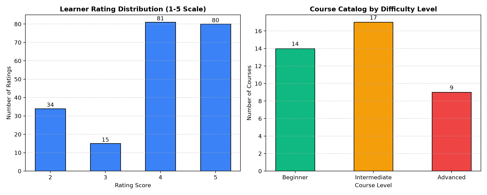

# CS467 Individual Mini-Project (MP-A14): Online Programming Tutorial and MOOC Recommender

## (a) Student and Project Information

- **Student Name:** Phan Đình Thành
- **Student ID:** 29211347776
- **Course & Section:** CS467 Advanced Artificial Intelligence — CS467A (No. 14)
- **Instructor:** Puri Vikram
- **Assigned Project Code:** MP-A14
- **Project Title:** Online Programming Tutorial and MOOC Recommender
- **Application Domain:** E-Learning and Self-Study Platforms

---

## (b) Problem Statement

Self-taught programmers and computer science learners face thousands of online programming tutorials and MOOCs spanning diverse stacks, tools, and difficulty levels. Choosing the next relevant course is challenging because keyword searches alone ignore a learner's completed background, while pure collaborative filtering fails on newly published courses with zero ratings (the item cold-start problem).

This project builds a Python recommendation engine that combines **Natural Language Processing (NLP)** over course curricula and topic tags with **Learner Rating Signals** to match free-text study goals, recommend personalized next courses, and explain recommendations with interpretable keyword and rating evidence.

---

## (c) Dataset Description

A domain-specific synthetic dataset representing an online programming MOOC catalog was created inside `data/`:

- **`data/items.csv` (40 Courses):** Contains `item_id`, `course_title`, `level` (`Beginner`, `Intermediate`, `Advanced`), `duration_hours`, `curriculum_summary`, and semicolon-separated `topic_tags`. Covers Python, Data Science, Machine Learning/AI, Web Frontend/Backend, DevOps/Cloud, Mobile, Java/C#, Algorithms, and Cybersecurity. Course `C040` (_Generative AI Agents and RAG Systems with LangChain_) is intentionally left unrated (`0` ratings) to evaluate cold-start handling.
- **`data/ratings.csv` (14 Learners, 210 Ratings):** Contains `user_id` (`U01`–`U14`), `item_id`, numeric `rating` (`1`–`5`), and qualitative `learner_review` notes.
- **Matrix Sparsity:** Out of $14 \times 40 = 560$ possible user-item pairs, 210 are observed, yielding **62.50% missing entries** (realistic sparse interaction matrix within the 40%–65% target range).



---

## (d) NLP and Recommendation Methods

### 1. NLP Preprocessing & Feature Extraction (`src/nlp_pipeline.py`)

- **Text Cleaning & Normalization:** Lowercases text, standardizes technical terms (e.g., `C#` $\rightarrow$ `csharp`, `.NET` $\rightarrow$ `dotnet`, `Node.js` $\rightarrow$ `nodejs`, `Scikit-Learn` $\rightarrow$ `scikitlearn`), removes punctuation while preserving hyphenated skill tokens, tokenizes text, and filters English stop words while retaining short programming identifiers (`c`, `r`, `go`).
- **TF-IDF Vectorization:** Fits a sublinear `TfidfVectorizer(ngram_range=(1, 2))` over combined course titles, levels, weighted topic tags, and curriculum summaries, producing a `(40, 1256)` sparse feature matrix.
- **Level/Skill Extraction & Query Vectorization:** Extracts target difficulty levels (`Beginner`, `Intermediate`, `Advanced`) and technical skills from any free-text query, transforms queries into the fitted TF-IDF vocabulary, and computes feature-wise products ($q_i \cdot d_i$) to surface top matching n-gram explanations.

### 2. Recommendation Models (`src/recommender.py`)

1. **Popularity Baseline:** Ranks qualified courses ($\ge 3$ ratings) using the Bayesian weighted rating formula:
   $$\text{Score}(i) = \frac{v}{v + m} R_i + \frac{m}{v + m} C$$
   where $R_i$ is the item's average rating, $v$ is its rating count, $m$ is the minimum rating threshold, and $C$ is the global mean rating, filtering out courses already completed by the target learner.
2. **NLP Content-Based Recommender:**
   - _Free-Text Goal Query:_ Computes cosine similarity between the query TF-IDF vector and all course vectors, adding a small `+0.05` alignment bonus when a course's difficulty level matches the learner's stated level.
   - _User-Profile Next-Course:_ Constructs each learner's profile vector as a rating-weighted average of their rated courses' TF-IDF vectors and ranks unseen courses by cosine similarity.
3. **Project-Specific Extension — User-Based Collaborative Filtering & Hybrid Recommender:**
   - Computes mean-centered cosine similarity across learners to predict ratings $\hat{r}_{u,i} = \bar{r}_u + \frac{\sum_{v \in N_k(u)} \text{sim}(u,v)(r_{v,i} - \bar{r}_v)}{\sum_{v \in N_k(u)} |\text{sim}(u,v)|}$.
   - Combines normalized CF predictions with NLP Content-Based similarity ($\alpha = 0.55$):
     $$\text{HybridScore}(u, i) = \alpha \cdot \text{Sim}_{\text{NLP}}(u, i) + (1 - \alpha) \cdot \frac{\hat{r}_{u,i} - 1}{4}$$

---

## (e) Installation and Run Commands

### 1. Environment Setup

```bash
git clone [https://github.com/dinhthanh275/cs467-miniproject-29211347776.git](https://github.com/dinhthanh275/cs467-miniproject-29211347776.git)
cd cs467-miniproject-29211347776
python -m venv venv
# On Windows PowerShell:
.\venv\Scripts\Activate.ps1
# On macOS/Linux:
# source venv/bin/activate
pip install -r requirements.txt
```
